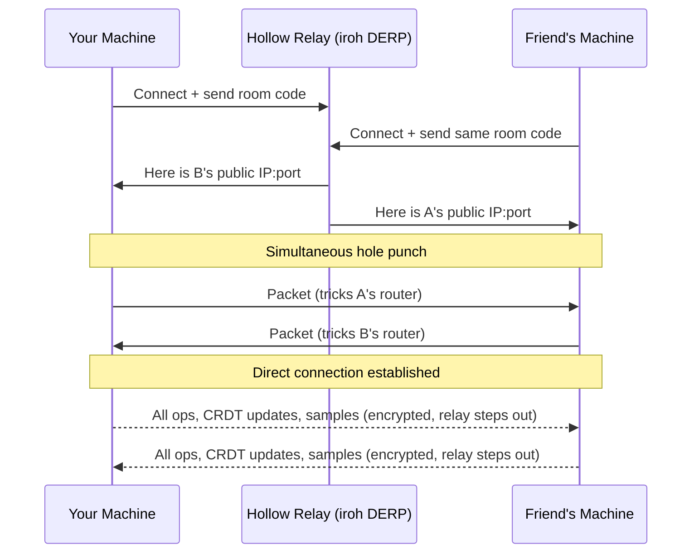
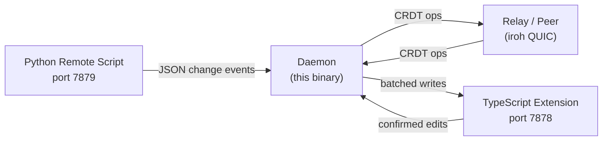

# Stage 1 — P2P Networking Foundation

> Status: **Building** — `cargo check` downloading dependencies now.

---

## What was built

```
sidecar/
├── Cargo.toml          ← Workspace: manages all Rust crates together
├── shared/             ← Protocol types used by both relay and daemon
│   └── src/
│       ├── envelope.rs ← Every packet's outer wrapper (kind, session, peer, seq, HLC, body)
│       ├── ops.rs      ← All edit types: NoteAdd, NoteSet, NoteDel, ClipCreate, TrackMove, ParamCommit, TempoSet
│       └── crdt.rs     ← Loro CRDT wrapper — apply_update, export_snapshot, export_since
├── relay/              ← The hollow relay server (host in cloud or VPS)
│   └── src/main.rs     ← Accepts connections, fans out packets, holds CRDT for reconnects
└── daemon/             ← Runs on each user's machine alongside Ableton
    └── src/main.rs     ← Connects to relay, bridges Remote Script ↔ relay ↔ Extension
```

---

## How hole punching works — step by step



**The relay only sees encrypted ciphertext during fallback. It never reads project data.**

---

## The message envelope

Every packet on the wire looks like this — serialized to ~30–60 bytes by `postcard`:

```
Envelope {
  version:    u8      // protocol version
  kind:       u8      // Op | Presence | Gesture | Control | Transport | Blob
  session_id: u128    // which session this belongs to
  peer_id:    u64     // who sent it
  seq:        u64     // monotonic counter (reliable channels)
  hlc:        u64     // hybrid logical clock (orders concurrent edits)
  body:       bytes   // payload — a Loro update blob for Op packets
}
```

---

## The QUIC channels

| Channel | Type | Carries | Speed |
|---|---|---|---|
| Control | Reliable | Join/leave, snapshots, permissions | Rare |
| Op | Reliable | CRDT edits (notes, clips, params) | ~60 Hz |
| Presence | Datagram | Selected track, playhead | 30 Hz |
| Gesture | Datagram | Live knob/fader drag values | 60–120 Hz |
| Transport | Reliable | Play, stop, scene launch | Rare |
| Blob | Reliable bulk | Sample files (content-addressed) | On demand |

---

## How the daemon bridges everything



---

## What Stage 2 builds on top of this

- **Python Remote Script** — registers listeners in Live, sends JSON events to daemon port 7879
- **TypeScript Extension** — connects to daemon port 7878, writes incoming ops into Ableton
- **Diff engine** in daemon — compares Remote Script events against CRDT mirror to produce minimal ops
- **Echo suppression** — tags remote writes so the Remote Script doesn't re-broadcast them

---

> [!TIP]
> To test Stage 1 with no Ableton at all: run `relay` on one terminal, run two `daemon` instances pointed at it, and send raw JSON between them. Watch the CRDT converge in both mirrors.
